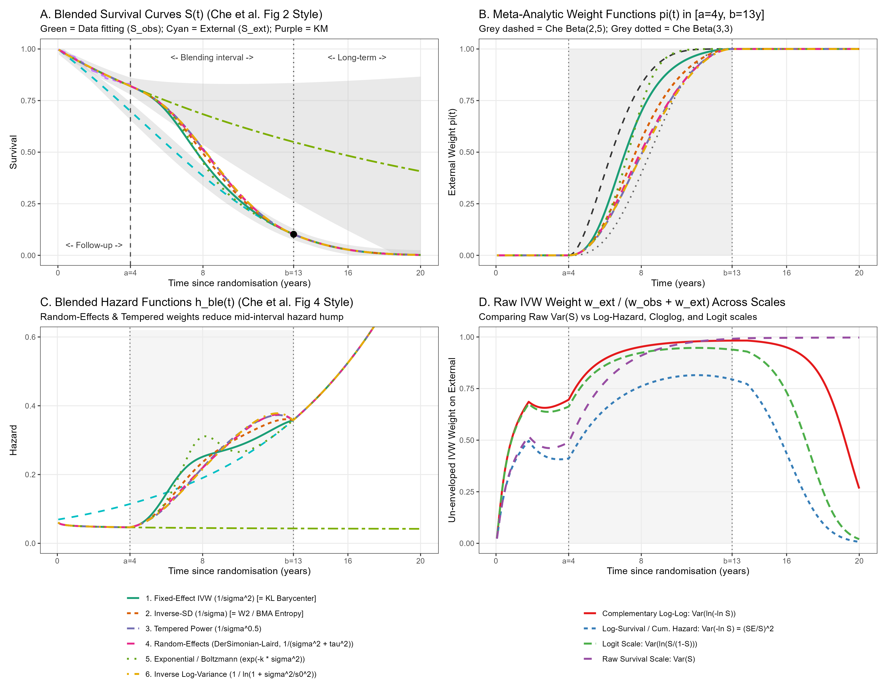
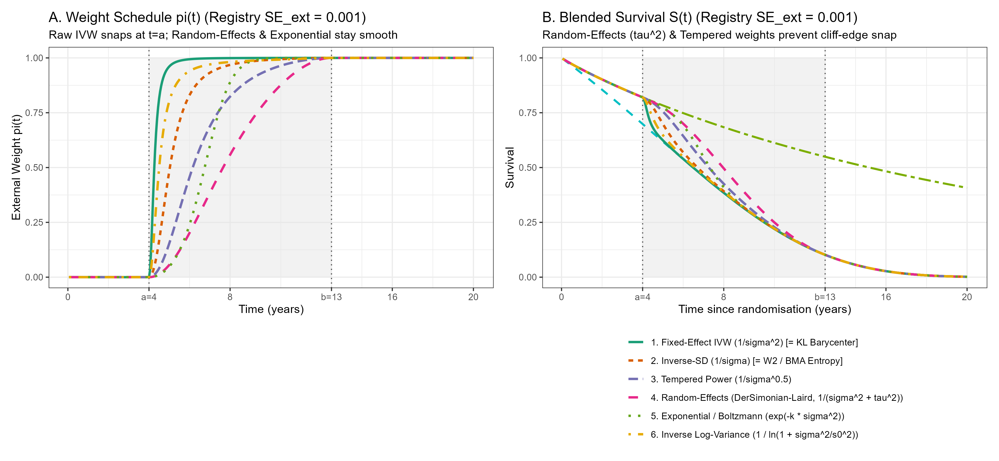
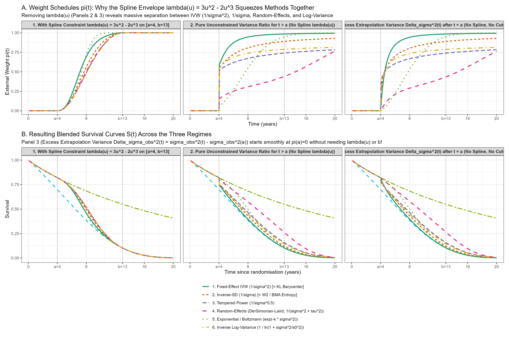
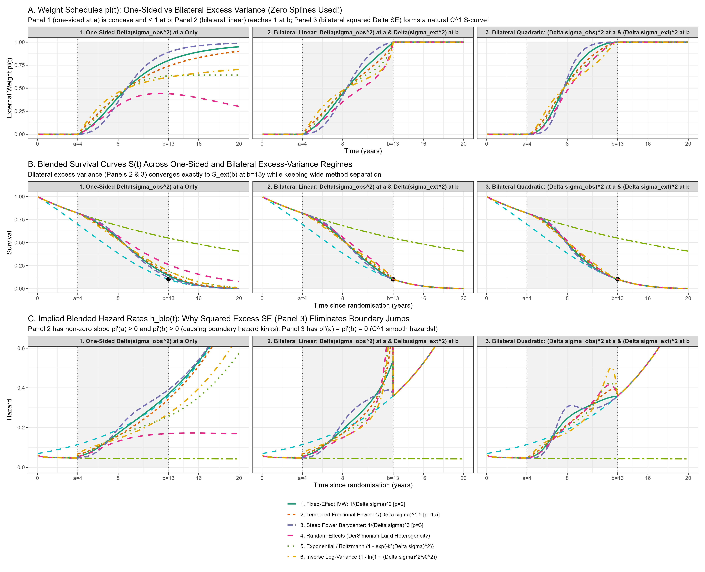
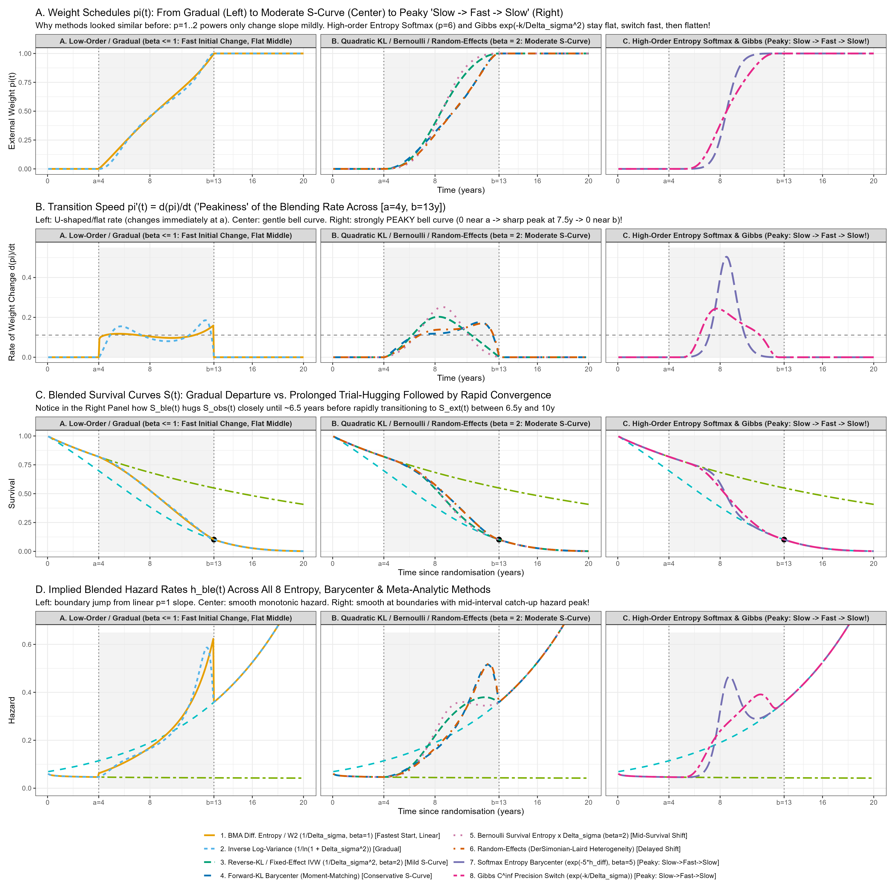
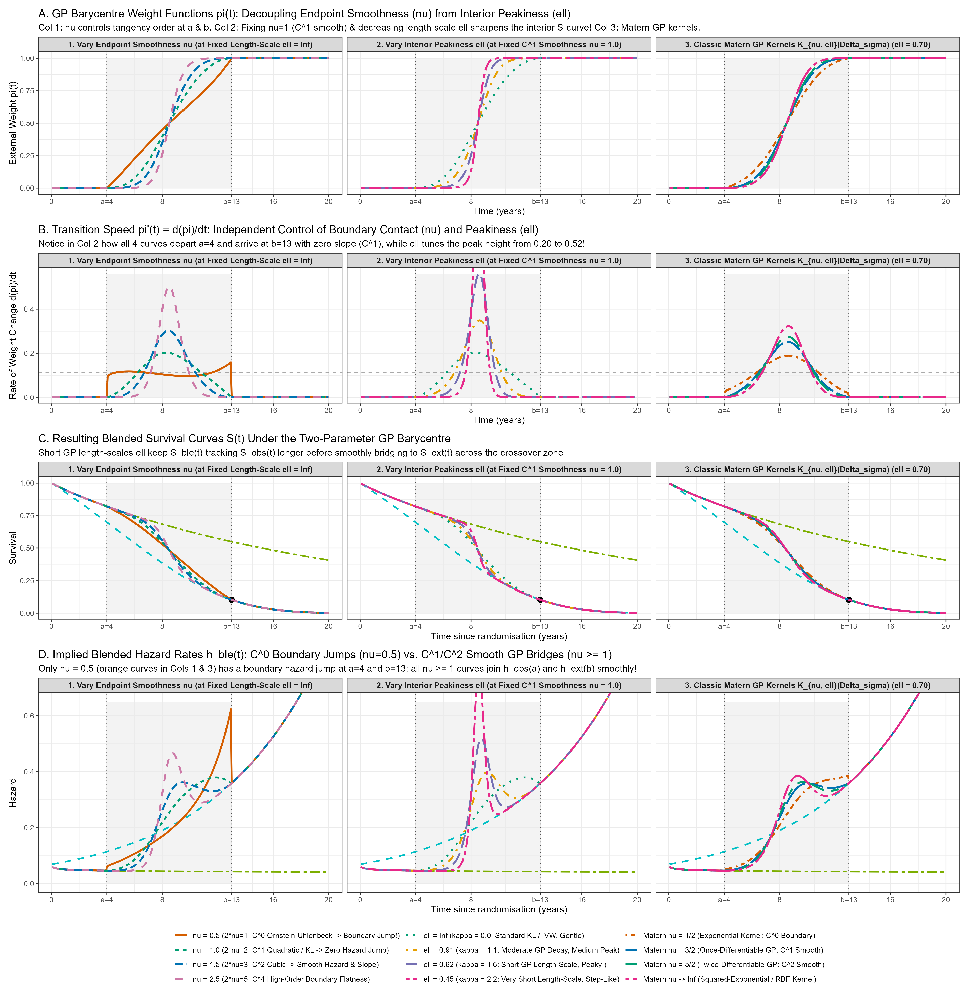

# Unifying Barycentric Survival Blending and Meta-Analytic Variance Weighting

**Companion Technical Note to `R/meta_analysis_variance_weighting.R` and `R/barycenter_kl_wasserstein.R`**  
*Calibrated to Che, Green, and Baio (2023), Medical Decision Making*

---

## 1. Overview: Survival Blending as Pointwise Two-Study Meta-Analysis

In the blended survival framework of Che, Green, and Baio (2023), the analyst combines an internal survival curve $S_{\text{obs}}(t \mid \boldsymbol{\theta}_{\text{obs}})$ fitted to short-term trial data over $[0, a]$ with an external survival curve $S_{\text{ext}}(t \mid \boldsymbol{\theta}_{\text{ext}})$ informed by registry data, observational cohorts, or expert elicitation across a blending interval $[a, b]$:

$$S_{\text{ble}}(t) = S_{\text{obs}}(t)^{1 - \pi(t)} \times S_{\text{ext}}(t)^{\pi(t)} \quad \Longleftrightarrow \quad H_{\text{ble}}(t) = \big(1 - \pi(t)\big) H_{\text{obs}}(t) + \pi(t) H_{\text{ext}}(t)$$

When replacing the subjective Beta weight schedule $\pi(t; \alpha, \beta, a, b) = F_{\text{Beta}}\left(\frac{t-a}{b-a}; \alpha, \beta\right)$ with a **self-calibrating variance-driven schedule**, the blending problem at each time point $t \in [a, b]$ is mathematically equivalent to a **pointwise two-study meta-analysis** (or Fréchet barycenter optimization) combining two uncertain estimates:
- **Study 1 (Internal RCT Extrapolation):** Point estimate $\hat{\mu}_{\text{obs}}(t)$ with epistemic variance $v_{\text{obs}}(t) = \sigma_{\text{obs}}^2(t)$.
- **Study 2 (External Registry / Expert Anchor):** Point estimate $\hat{\mu}_{\text{ext}}(t)$ with epistemic variance $v_{\text{ext}}(t) = \sigma_{\text{ext}}^2(t)$.

This document establishes the exact equivalence between **Information/Wasserstein Barycenters** and **Meta-Analytic Pooling Estimators**, and evaluates six variance-weighting functional forms (inverse, power/root, random-effects, exponential/Boltzmann, and logarithmic) alongside four survival transformation scales.

---

## 2. Exact Equivalence: Reverse-KL Barycenter = Fixed-Effect Inverse-Variance Weighting (IVW)

At any time $t$, suppose the epistemic uncertainty of the two survival models (on the survival scale $S(t)$ or cumulative hazard scale $H(t) = -\ln S(t)$) is represented by Gaussian predictive distributions $P_{\text{obs}, t} = \mathcal{N}\big(\hat{\mu}_{\text{obs}}(t), \sigma_{\text{obs}}^2(t)\big)$ and $P_{\text{ext}, t} = \mathcal{N}\big(\hat{\mu}_{\text{ext}}(t), \sigma_{\text{ext}}^2(t)\big)$.

Consider finding the intermediate barycenter distribution $M_t = \mathcal{N}\big(\mu_M(t), \sigma_M^2(t)\big)$ that minimizes the weighted sum of **Reverse Kullback–Leibler (KL)** divergences:

$$\min_{\mu_M, \sigma_M} \Big\{ \big(1 - \lambda(t)\big) \, D_{\mathrm{KL}}\big(M_t \parallel P_{\text{obs}, t}\big) + \lambda(t) \, D_{\mathrm{KL}}\big(M_t \parallel P_{\text{ext}, t}\big) \Big\}$$

where $\lambda(t) \in [0, 1]$ is a baseline boundary progression schedule satisfying $\lambda(a) = 0$ and $\lambda(b) = 1$ (e.g., the Hermite smoothstep $\lambda(t) = 3u^2 - 2u^3$ with $u = \frac{t-a}{b-a}$).

Expanding the Gaussian KL divergence $D_{\mathrm{KL}}(M_t \parallel P_i) = \frac{1}{2}\left[\ln\frac{\sigma_i^2}{\sigma_M^2} + \frac{\sigma_M^2 + (\mu_M - \hat{\mu}_i)^2}{\sigma_i^2} - 1\right]$ and setting the derivative with respect to $\mu_M(t)$ to zero:

$$\frac{\partial}{\partial \mu_M} = \big(1 - \lambda(t)\big)\frac{\mu_M(t) - \hat{\mu}_{\text{obs}}(t)}{\sigma_{\text{obs}}^2(t)} + \lambda(t)\frac{\mu_M(t) - \hat{\mu}_{\text{ext}}(t)}{\sigma_{\text{ext}}^2(t)} = 0$$

Solving for $\mu_M(t)$ yields:

$$\mu_M^*(t) = \big(1 - \pi_{\text{IVW}}(t)\big)\hat{\mu}_{\text{obs}}(t) + \pi_{\text{IVW}}(t)\hat{\mu}_{\text{ext}}(t), \quad \text{where} \quad \pi_{\text{IVW}}(t) = \frac{\lambda(t) \, w_{\text{ext}}(t)}{\big(1 - \lambda(t)\big) w_{\text{obs}}(t) + \lambda(t) \, w_{\text{ext}}(t)}$$

with raw weights:

$$w_{\text{obs}}(t) = \frac{1}{\sigma_{\text{obs}}^2(t)}, \quad w_{\text{ext}}(t) = \frac{1}{\sigma_{\text{ext}}^2(t)}$$

When $\lambda(t) = 0.5$ (uninformative prior across $[a, b]$), this simplifies strictly to **classical Fixed-Effect Inverse-Variance Weighting (IVW)**:

$$\pi_{\text{IVW}}^{\text{raw}}(t) = \frac{1 / \sigma_{\text{ext}}^2(t)}{1 / \sigma_{\text{obs}}^2(t) + 1 / \sigma_{\text{ext}}^2(t)} = \frac{\sigma_{\text{obs}}^2(t)}{\sigma_{\text{obs}}^2(t) + \sigma_{\text{ext}}^2(t)}$$

> **Note on Pointwise Self-Weighted Optimization:**  
> If one instead attempts to optimize $\min_{\pi \in [0, 1]} \big\{ (1 - \pi) D(P_{\text{obs}}, P_{\text{blend}}(\pi)) + \pi D(P_{\text{blend}}(\pi), P_{\text{ext}}) \big\}$ where the decision variable $\pi$ appears *both* inside $P_{\text{blend}}(\pi)$ and as the outer weight, the objective evaluates to $0$ at both endpoints ($\pi = 0$ and $\pi = 1$) and is strictly concave on $(0, 1)$, causing the optimizer to trivially collapse to $0$ or $1$. Fixing the outer weights via $\lambda(t)$ and the curve variances $\sigma_i^2(t)$ guarantees a strictly convex objective with a unique interior optimum $\pi^*(t) \in (0, 1)$.

---

## 3. Six Meta-Analytic Variance-Weighting Families for Survival Blending

While Fixed-Effect IVW ($w_i = 1/\sigma_i^2$) is optimal when two curves estimate the exact same parameter with comparable sample sizes, HTA survival blending often pairs a **small clinical trial** ($N \approx 100\text{--}400$) with a **massive external registry or national life table** ($N > 10,000$, where $\sigma_{\text{ext}}^2 \to 0$). Under raw IVW, a near-zero external variance forces $\pi_{\text{IVW}}(t) \to 1$ immediately after $t = a$ ("hyper-precision snapping").

Borrowing from meta-analysis, opinion pooling, and statistical physics provides six distinct functional forms for mapping curve variances $v_i(t) = \sigma_i^2(t)$ to blending weights $w_i(t)$:

| # | Meta-Analytic Family | Weight Formula $w_i(t)$ | Un-enveloped External Weight $\frac{w_{\text{ext}}}{w_{\text{obs}} + w_{\text{ext}}}$ | Equivalent Information / Barycenter Theory | Behavior in Survival Blending |
| :- | :--- | :--- | :--- | :--- | :--- |
| **1** | **Fixed-Effect Inverse-Variance (IVW)** | $\frac{1}{\sigma_i^2(t)}$ | $\frac{\sigma_{\text{obs}}^2}{\sigma_{\text{obs}}^2 + \sigma_{\text{ext}}^2}$ | **Reverse-KL Barycenter** & $\tau$-Weighted $W_2^2$ Barycenter | Fast early transition toward external anchor (mimics $\text{Beta}(2,5)$); sensitive to extreme registry precision. |
| **2** | **Inverse-SD Weighting ($\gamma = 0.5$)** | $\frac{1}{\sigma_i(t)}$ | $\frac{\sigma_{\text{obs}}}{\sigma_{\text{obs}} + \sigma_{\text{ext}}}$ | **Time-Varying BMA Entropy** ($\Delta\text{ELPD}$) & $1/\sigma$-Wasserstein Barycenter | Square-root tempering of variance ratio; lies smoothly between $\text{Beta}(2,5)$ and $\text{Beta}(3,3)$. |
| **3** | **Tempered Power IVW ($\gamma \in (0, 1)$)** | $\left(\frac{1}{\sigma_i^2(t)}\right)^\gamma$ | $\frac{1}{1 + (\sigma_{\text{ext}}^2 / \sigma_{\text{obs}}^2)^\gamma}$ | **$\alpha$-Divergence / Rényi / Chernoff Pooling** (Linear in log-variance) | $\text{logit}(\pi) = \gamma \ln(\sigma_{\text{obs}}^2 / \sigma_{\text{ext}}^2)$; tunable dampening ($\gamma = 0.25$) against registry dominance. |
| **4** | **Random-Effects (DerSimonian–Laird)** | $\frac{1}{\sigma_i^2(t) + c\,\tau_{\text{het}}^2(t)}$ | $\frac{\sigma_{\text{obs}}^2 + c\,\tau_{\text{het}}^2}{\sigma_{\text{obs}}^2 + \sigma_{\text{ext}}^2 + 2c\,\tau_{\text{het}}^2}$ | **Hierarchical Empirical Bayes** with between-source heterogeneity $\tau_{\text{het}}^2$ | Incorporates curve separation $\tau_{\text{het}}^2 = \max(0, (\mu_{\text{obs}}-\mu_{\text{ext}})^2 - (v_{\text{obs}}+v_{\text{ext}}))$; prevents cliff-edge snapping when $\sigma_{\text{ext}} \to 0$. |
| **5** | **Exponential / Boltzmann (Softmax)** | $\exp\left(-\kappa \frac{\sigma_i^2(t)}{\bar{v}}\right)$ | $\frac{1}{1 + \exp\big(-\frac{\kappa}{\bar{v}}(\sigma_{\text{obs}}^2 - \sigma_{\text{ext}}^2)\big)}$ | **Gibbs / Boltzmann Softmax** on variance difference | Depends on **absolute variance difference** $(\sigma_{\text{obs}}^2 - \sigma_{\text{ext}}^2)$ rather than ratio $\sigma_{\text{obs}}^2 / \sigma_{\text{ext}}^2$; completely immune to $\sigma_{\text{ext}} = 0$. |
| **6** | **Inverse Log-Variance (Entropy)** | $\frac{1}{\ln\big(1 + \sigma_i^2(t)/\sigma_0^2\big)}$ | $\frac{\ln(1 + \sigma_{\text{obs}}^2/\sigma_0^2)}{\ln(1 + \sigma_{\text{obs}}^2/\sigma_0^2) + \ln(1 + \sigma_{\text{ext}}^2/\sigma_0^2)}$ | **Differential Gaussian Entropy** $\mathcal{H}_i(t) \propto \ln \sigma_i^2(t)$ | Logarithmic compression of explosive tail variance; produces a gradual, symmetric S-curve. |

---

## 4. Transformation Scales for Survival Variance (Fixing Tail Variance Collapse)

In survival meta-analysis (e.g., Parmar et al., 1998; Williamson et al., 2002; NICE DSU TSD), pooling survival curves using the raw probability-scale variance $\text{Var}(\hat{S}(t)) = \sigma_S^2(t)$ suffers from a boundary pathology: because $S(t) \in [0, 1]$, as $S_{\text{ext}}(t) \to 0$ in the late tail, its raw standard error $\sigma_{S, \text{ext}}(t)$ **artificially shrinks toward zero** faster than $\sigma_{S, \text{obs}}(t)$ (where $S_{\text{obs}}(t)$ plateaus around $0.40\text{--}0.50$).

Applying the Delta method $\text{Var}\big(g(\hat{S})\big) \approx \big[g'(\hat{S})\big]^2 \sigma_S^2$ yields four candidate variance scales:

1. **Raw Survival Scale ($g(S) = S$):**
   $$v_{\text{surv}}(t) = \sigma_S^2(t)$$
   *Pathology:* Confounds epistemic uncertainty with the level of $S(t)$ near $0$ and $1$.
2. **Log-Survival / Cumulative Hazard Scale ($g(S) = -\ln S = H$):**
   $$v_{\ln S}(t) = \left(\frac{\sigma_S(t)}{\hat{S}(t)}\right)^2 = \text{CV}_S^2(t)$$
   *Interpretation:* Equals the **squared Coefficient of Variation (relative standard error)** of survival. Because geometric blending $S_{\text{ble}} = S_{\text{obs}}^{1-\pi} S_{\text{ext}}^\pi$ is linear on the cumulative hazard scale $H(t) = -\ln S(t)$, **$\text{Var}(-\ln \hat{S}) = (\sigma_S / \hat{S})^2$ is the exact natural variance scale for Che et al.'s geometric blending equation**.
3. **Complementary Log-Log Scale ($g(S) = \ln(-\ln S) = \ln H$):**
   $$v_{\text{cloglog}}(t) = \left(\frac{\sigma_S(t)}{\hat{S}(t) \ln \hat{S}(t)}\right)^2$$
   *Interpretation:* Standard unconstrained scale for confidence intervals in `survival` / `flexsurv` and proportional hazards meta-analysis.
4. **Logit Survival Scale ($g(S) = \ln\frac{S}{1-S}$):**
   $$v_{\text{logit}}(t) = \left(\frac{\sigma_S(t)}{\hat{S}(t)\big(1 - \hat{S}(t)\big)}\right)^2$$
   *Interpretation:* Symmetrically penalizes boundary compression at both $S \to 1$ and $S \to 0$.

---

## 5. Empirical Results on the Che et al. (2023) Case Study

Executing [`R/meta_analysis_variance_weighting.R`](file:///C:/Users/Nathan/Documents/R/dynblend/R/meta_analysis_variance_weighting.R) on the Che et al. (2023) CLL-8 setup ($a = 4\text{y}$, $b = 13\text{y}$, 20-year horizon) produces the following quantitative comparison:

| Category | Blending / Weighting Method | 20-Year RMST (Years) | Survival at 6y (%) | Survival at 8y (%) | Survival at 10y (%) | Peak Hazard in $[0, 13\text{y}]$ |
| :--- | :--- | :---: | :---: | :---: | :---: | :---: |
| **Anchors** | Data fitting only ($S_{\text{obs}}$, unadjusted) | 12.99 | 74.8% | 68.4% | 62.6% | 0.061 |
| | External info only ($S_{\text{ext}}$) | 6.90 | 53.8% | 38.5% | 25.0% | 0.357 |
| **Static Beta (Che 2023)** | Static $\text{Beta}(3,3)$ | 8.06 | 73.0% | 54.4% | 30.3% | 0.372 |
| | Static $\text{Beta}(2,5)$ | 7.57 | 65.6% | 42.4% | 25.4% | 0.357 |
| **Meta-Analytic Family** *(on Cum. Hazard Scale)* | **1. Fixed-Effect IVW ($1/\sigma^2$) [= KL Barycenter]** | **7.75** | 69.8% | 45.8% | 26.8% | **0.357** |
| | **2. Inverse-SD ($1/\sigma$) [= $W_2$ / BMA Entropy]** | **7.88** | 70.9% | 49.5% | 28.5% | **0.361** |
| | **3. Tempered Power ($1/\sigma^{0.5}$)** | **7.97** | 71.4% | 51.6% | 29.9% | 0.373 |
| | **4. Random-Effects (DerSimonian–Laird)** | **7.95** | 71.2% | 51.1% | 29.8% | 0.375 |
| | **5. Exponential / Boltzmann ($\exp(-\kappa \sigma^2)$)** | **7.73** | 71.0% | 45.1% | 25.3% | **0.357** |
| | **6. Inverse Log-Variance ($1/\ln(1+\sigma^2/\sigma_0^2)$)** | **7.98** | 71.3% | 51.8% | 30.2% | 0.378 |
| **Variance Scale** *(under Fixed-Effect IVW)* | Raw Survival Scale: $\text{Var}(S)$ | 7.57 | 66.9% | 41.3% | 25.3% | 0.357 |
| | **Log-Survival / Cum. Hazard: $\text{Var}(-\ln S)$** | **7.75** | 69.8% | 45.8% | 26.8% | 0.357 |
| | Complementary Log-Log: $\text{Var}(\ln(-\ln S))$ | 7.46 | 62.4% | 39.9% | 25.2% | 0.357 |
| | Logit Scale: $\text{Var}(\ln\frac{S}{1-S})$ | 7.51 | 64.0% | 40.8% | 25.4% | 0.357 |

### Figure 1: Meta-Analytic Weighting Families & Variance Transformation Scales

### Figure 2: Hyper-Precision Stress Test ($\text{SE}_{\text{ext}} = 0.001$, National Registry / Life Table)
When the external curve comes from a massive population registry or national life table where $\sigma_{\text{ext}}(t) \approx 0.001$, **Fixed-Effect IVW ($1/\sigma^2$)** snaps almost instantaneously to $\pi(t) = 1$ right after $t = a = 4\text{y}$ (green curve below), creating a cliff-edge drop in survival. By contrast, **Random-Effects (DerSimonian–Laird)**, **Tempered Power ($1/\sigma^{0.5}$)**, and **Exponential / Boltzmann ($\exp(-\kappa\sigma^2)$)** absorb the between-source heterogeneity or evaluate absolute variance differences, preserving a smooth, clinically plausible transition across $[4\text{y}, 13\text{y}]$.

---

## 6. Why Imposing the Spline Envelope $\lambda(u) = 3u^2 - 2u^3$ Compresses Differences Between Methods

In the enveloped formula:
$$\pi(t) = \frac{\lambda(u) \, w_{\text{ext}}(t)}{\big(1 - \lambda(u)\big) w_{\text{obs}}(t) + \lambda(u) \, w_{\text{ext}}(t)}, \quad \lambda(u) = 3u^2 - 2u^3$$
the Cubic Hermite spline $\lambda(u)$ acts as a strong multiplicative prior that forces $\pi(t) \sim 3u^2 \to 0$ near $t = a$ and $1 - \pi(t) \sim 3(1-u)^2 \to 0$ near $t = b$. Whenever the variance ratio $w_{\text{ext}}(t)/w_{\text{obs}}(t)$ is moderate (e.g., between $2$ and $10$), $\lambda(u)$ dominates the trajectory and squeezes all weighting schemes into a narrow band.

Executing [`R/lambda_constraint_diagnostic.R`](file:///C:/Users/Nathan/Documents/R/dynblend/R/lambda_constraint_diagnostic.R) compares three regimes:
1. **Regime 1 (With $\lambda(u) = 3u^2 - 2u^3$ on $[a, b]$):** The spline envelope pinches all six methods together at $t = a$ and $t = b$.
2. **Regime 2 (Pure Unconstrained Variance Ratio $\frac{w_{\text{ext}}(t)}{w_{\text{obs}}(t) + w_{\text{ext}}(t)}$ for $t > a$):** Removing $\lambda(u)$ exposes large structural differences between Fixed-Effect IVW ($1/\sigma^2$), Inverse-SD ($1/\sigma$), Random-Effects, and Exponential weighting, but exhibits a step jump at $t = a^+$ because $\sigma_{\text{obs}}^2(a) > 0$.
3. **Regime 3 (Excess Extrapolation Variance $\Delta\sigma_{\text{obs}}^2(t) = \sigma_{\text{obs}}^2(t) - \sigma_{\text{obs}}^2(a)$ for $t > a$, No Spline $\lambda(u)$):** Subtracting the baseline in-trial variance at $t = a$ ensures $\Delta\sigma_{\text{obs}}^2(a) = 0 \implies \pi(a) = 0$ **naturally without needing a spline $\lambda(u)$**, while allowing the different variance rules to diverge freely according to how rapidly trial uncertainty grows beyond $t = a$.

---

## 7. Bilateral Excess Variance: $\Delta\sigma_{\text{obs}}(t)$ at $t = a$ and $\Delta\sigma_{\text{ext}}(t)$ at $t = b$

### 7.1 Why One-Sided Excess Variance Produces Concave Weight Curves
When using one-sided excess variance $\Delta(\sigma_{\text{obs}}^2)(t) = \sigma_{\text{obs}}^2(t) - \sigma_{\text{obs}}^2(a)$ against an un-anchored external variance $\sigma_{\text{ext}}^2$, the resulting weight has the Michaelis–Menten / Hill saturation form:
$$\pi(t) = \frac{x(t)}{x(t) + c}, \quad x(t) = \sigma_{\text{obs}}^2(t) - \sigma_{\text{obs}}^2(a), \quad c = \sigma_{\text{ext}}^2$$
Because $\frac{d^2}{dx^2}\left(\frac{x}{x+c}\right) = -\frac{2c}{(x+c)^3} < 0$, $\pi(t)$ is **strictly concave** whenever $x(t)$ grows roughly linearly: it has its steepest slope immediately at $t = a^+$ ($\pi'(a^+) > 0$, causing a step jump in the blended hazard $h_{\text{ble}}(t)$) and levels off below $1$ at $t = b$.

### 7.2 Bilateral Anchoring at $t = a$ and $t = b$
On the cumulative hazard scale $H(t) = -\ln S(t)$, both standard errors $\sigma_{\text{obs}}(t) = \text{SE}(H_{\text{obs}}(t))$ and $\sigma_{\text{ext}}(t) = \text{SE}(H_{\text{ext}}(t))$ are strictly monotonically increasing on $[a, b]$. We can therefore define **bilateral excess uncertainties** anchored symmetrically at the two boundaries of $[a, b]$:
- **Observed excess extrapolation uncertainty beyond $t = a$:**
  $$\Delta\sigma_{\text{obs}}(t) = \sigma_{\text{obs}}(t) - \sigma_{\text{obs}}(a) \quad \Big(\text{vanishes at } t = a\Big)$$
- **External remaining uncertainty prior to the long-term anchor $t = b$:**
  $$\Delta\sigma_{\text{ext}}(t) = \sigma_{\text{ext}}(b) - \sigma_{\text{ext}}(t) \quad \Big(\text{vanishes at } t = b\Big)$$

### 7.3 Linear Difference of Variances vs. Squared Excess Standard Error ($C^1$ Smoothness Theorem)
There is a fundamental mathematical difference between taking the **difference of variances** $\Delta(\sigma_i^2)$ versus the **squared excess standard error** $(\Delta\sigma_i)^2$:

1. **Bilateral Difference of Variances (Linear Order $O(|t - \text{anchor}|)$):**
   $$\Delta(\sigma_{\text{obs}}^2)(t) = \sigma_{\text{obs}}^2(t) - \sigma_{\text{obs}}^2(a) \approx 2\sigma_{\text{obs}}(a)\sigma_{\text{obs}}'(a)\,(t - a) = O(t - a)$$
   $$\Delta(\sigma_{\text{ext}}^2)(t) = \sigma_{\text{ext}}^2(b) - \sigma_{\text{ext}}^2(t) \approx 2\sigma_{\text{ext}}(b)\sigma_{\text{ext}}'(b)\,(b - t) = O(b - t)$$
   Because $\sigma_{\text{obs}}(a) > 0$ and $\sigma_{\text{ext}}(b) > 0$, $\Delta(\sigma_i^2)$ vanishes only **linearly** at $a$ and $b$. Consequently, $\pi(a) = 0$ and $\pi(b) = 1$, but the boundary slopes are non-zero ($\pi'(a^+) > 0$ and $\pi'(b^-) > 0$), which creates discontinuous jumps in the blended hazard $h_{\text{ble}}(t) = (1-\pi)h_{\text{obs}} + \pi h_{\text{ext}} + \pi'(t)(H_{\text{ext}} - H_{\text{obs}})$ at $t = a$ and $t = b$ (Panel 2 below).

2. **Bilateral Squared Excess Standard Error (Quadratic Order $O(|t - \text{anchor}|^2)$):**
   $$V_{\text{obs}}^{\Delta}(t) = \big(\Delta\sigma_{\text{obs}}(t)\big)^2 = \big(\sigma_{\text{obs}}(t) - \sigma_{\text{obs}}(a)\big)^2 \approx \big(\sigma_{\text{obs}}'(a)\big)^2 (t - a)^2 = O\big((t - a)^2\big)$$
   $$V_{\text{ext}}^{\Delta}(t) = \big(\Delta\sigma_{\text{ext}}(t)\big)^2 = \big(\sigma_{\text{ext}}(b) - \sigma_{\text{ext}}(t)\big)^2 \approx \big(\sigma_{\text{ext}}'(b)\big)^2 (b - t)^2 = O\big((b - t)^2\big)$$
   Applying Inverse-Variance Weighting ($w_i = 1 / V_i^{\Delta}$), Random-Effects, Exponential/Boltzmann ($1 - \exp(-k V_i^{\Delta})$), or Inverse Log-Variance ($\ln(1 + V_i^{\Delta}/s_0^2)$) to $(V_{\text{obs}}^{\Delta}(t), V_{\text{ext}}^{\Delta}(t))$ yields:
   $$\pi_{\text{IVW}}^{\Delta}(t) = \frac{\big(\sigma_{\text{obs}}(t) - \sigma_{\text{obs}}(a)\big)^2}{\big(\sigma_{\text{obs}}(t) - \sigma_{\text{obs}}(a)\big)^2 + \big(\sigma_{\text{ext}}(b) - \sigma_{\text{ext}}(t)\big)^2}$$
   Because the numerator vanishes **quadratically** at $t = a$ and the second term in the denominator vanishes **quadratically** at $t = b$, we obtain:
   $$\pi(a) = 0, \quad \pi(b) = 1, \quad \text{and} \quad \pi'(a) = \pi'(b) = 0$$
   **purely from the standard errors of the two survival models**, with **zero artificial spline $\lambda(u)$ required** (Panel 3 below).

---

## 8. How the Barycentre Idea Is Generalised (From Gradual to "Peaky" Slow $\to$ Fast $\to$ Slow Transitions)

### 8.1 Step 0: The Basic Barycentre and Why KL Barycentre = Inverse-Variance Weighting
At any time $t$, we have two uncertain estimates of the cumulative hazard $H(t) = -\ln S(t)$:
- **Observed trial model:** $P_{\text{obs}}(t) = \mathcal{N}\big(\mu_{\text{obs}}(t),\, \sigma_{\text{obs}}^2(t)\big)$
- **External long-term model:** $P_{\text{ext}}(t) = \mathcal{N}\big(\mu_{\text{ext}}(t),\, \sigma_{\text{ext}}^2(t)\big)$

A **barycentre** is the blended point $\mu_{\text{blend}}(t)$ that sits at the "center of mass" between $P_{\text{obs}}(t)$ and $P_{\text{ext}}(t)$ by minimizing the sum of divergences $D$ to both distributions:
$$\min_{\mu} \; \Big\{ D\big(\mu,\, P_{\text{obs}}(t)\big) + D\big(\mu,\, P_{\text{ext}}(t)\big) \Big\}$$

Even with **no manual weights** in front of the two terms, the variances $\sigma_{\text{obs}}^2(t)$ and $\sigma_{\text{ext}}^2(t)$ enter automatically through the geometry of $D$:
- **Euclidean distance** $(\mu - \mu_i)^2$ ignores variance completely and yields the 50/50 average ($\pi = 0.5$).
- **Kullback–Leibler (KL) divergence** from $\mu$ to a Gaussian $\mathcal{N}(\mu_i, \sigma_i^2)$ is proportional to the squared standardized ($Z$-score) distance:
  $$D_{\text{KL}}\big(\mu \,\|\, P_i(t)\big) \propto \left(\frac{|\mu - \mu_i(t)|}{\sigma_i(t)}\right)^2$$
  Minimizing $\frac{(\mu - \mu_{\text{obs}})^2}{\sigma_{\text{obs}}^2(t)} + \frac{(\mu - \mu_{\text{ext}})^2}{\sigma_{\text{ext}}^2(t)}$ with respect to $\mu$ yields:
  $$\mu^*(t) = \big(1 - \pi(t)\big)\mu_{\text{obs}}(t) + \pi(t)\mu_{\text{ext}}(t), \qquad \pi(t) = \frac{1/\sigma_{\text{ext}}^2(t)}{1/\sigma_{\text{obs}}^2(t) + 1/\sigma_{\text{ext}}^2(t)} = \frac{\sigma_{\text{obs}}^2(t)}{\sigma_{\text{obs}}^2(t) + \sigma_{\text{ext}}^2(t)}$$
  Thus, a **KL barycentre is identically Fixed-Effect Inverse-Variance Weighting ($1/\sigma_i^2$)** because missing a narrow (low-$\sigma$) distribution incurs a much larger KL divergence penalty than missing a wide (high-$\sigma$) distribution.

---

### 8.2 Three Generalisations of the Barycentre Principle

Once the KL barycentre is seen as minimizing the sum of squared $Z$-scores $\left(\frac{|\mu - \mu_i|}{\sigma_i}\right)^2$, we generalise it in three complementary ways:

#### Generalisation 1: Generalising the Loss Exponent $p$ ($L_p$ Standardized Barycentre)
Instead of squaring the standardized error ($p = 2$, KL divergence), we minimize the **$p$-th power** of the standardized error:
$$\min_{\mu} \; \left\{ \left(\frac{|\mu - \mu_{\text{obs}}(t)|}{\sigma_{\text{obs}}(t)}\right)^p + \left(\frac{|\mu - \mu_{\text{ext}}(t)|}{\sigma_{\text{ext}}(t)}\right)^p \right\}$$
Setting the derivative $\frac{\partial}{\partial \mu} = 0$ gives:
$$p\,\frac{(\mu - \mu_{\text{obs}})^{p-1}}{\sigma_{\text{obs}}^p} = p\,\frac{(\mu_{\text{ext}} - \mu)^{p-1}}{\sigma_{\text{ext}}^p} \implies \frac{\mu - \mu_{\text{obs}}}{\mu_{\text{ext}} - \mu} = \left(\frac{\sigma_{\text{obs}}(t)}{\sigma_{\text{ext}}(t)}\right)^{\frac{p}{p-1}}$$
Solving for the external weight $\pi(t) = \frac{\mu - \mu_{\text{obs}}}{\mu_{\text{ext}} - \mu_{\text{obs}}}$ yields the power-precision family with exponent $\beta = \frac{p}{p-1}$:
$$\pi_\beta(t) = \frac{\sigma_{\text{obs}}(t)^\beta}{\sigma_{\text{obs}}(t)^\beta + \sigma_{\text{ext}}(t)^\beta}, \qquad \beta = \frac{p}{p-1}$$

- **$p \to \infty$ ($\beta = 1$, Minimax / $W_2$ / Standard BMA Differential Entropy):** Equalizes the maximum $Z$-score $\frac{|\mu - \mu_i|}{\sigma_i}$, giving $\pi(t) = \frac{\sigma_{\text{obs}}}{\sigma_{\text{obs}} + \sigma_{\text{ext}}}$ ($1/\sigma$ weighting)—a **gradual, nearly straight line** across $[a, b]$ whose rate of change $\pi'(t)$ is flat across the interval.
- **$p = 2$ ($\beta = 2$, KL Divergence / Fixed-Effect IVW):** Minimizes the sum of squared $Z$-scores, giving $\pi(t) = \frac{\sigma_{\text{obs}}^2}{\sigma_{\text{obs}}^2 + \sigma_{\text{ext}}^2}$ ($1/\sigma^2$ weighting)—a **mild S-curve** (only $2\times$ the midpoint slope of $\beta = 1$, which is why $\beta = 1$ and $\beta = 2$ look visually similar).
- **$p = 1.25$ ($\beta = \frac{1.25}{0.25} = 5$, $L_{1.25}$ Robust Barycentre):** Just as an $L_1$ loss pulls an estimator toward the median (the tighter distribution) rather than the mean, choosing $p \to 1^+$ ($\beta = 5$) causes the barycentre to **hug the more precise curve ($S_{\text{obs}}$) tightly** while $\sigma_{\text{obs}}(t) < \sigma_{\text{ext}}(t)$ (**slow to change**), **switch rapidly** as soon as $\sigma_{\text{obs}}(t)$ overtakes $\sigma_{\text{ext}}(t)$ (**then fast**), and **hug $S_{\text{ext}}$ tightly** afterward (**then slow**).

#### Generalisation 2: Entropic / Variational Free-Energy Barycentre (Softmax & Gibbs)
From **Information Theory**, the exact same family arises by treating the weight vector $(1-\pi, \pi)$ as a probability distribution over the two models chosen to minimize **Expected Uncertainty Cost $\mathcal{E}_i(t)$ minus Shannon Entropy** (Variational Free Energy / Minimum Cross-Entropy):
$$\min_{\pi \in [0,1]} \; \Big\{ \underbrace{(1-\pi)\,\mathcal{E}_{\text{obs}}(t) + \pi\,\mathcal{E}_{\text{ext}}(t)}_{\text{Expected Uncertainty Cost}} \;+\; \underbrace{\frac{1}{\beta}\Big[(1-\pi)\ln(1-\pi) + \pi\ln\pi\Big]}_{\text{Shannon Entropy Penalty (smooths }\pi\text{)}} \Big\}$$
Setting $\frac{\partial}{\partial \pi} = 0$ gives the closed-form **Boltzmann / Softmax distribution**:
$$\pi^*(t) = \frac{\exp\big(-\beta\,\mathcal{E}_{\text{ext}}(t)\big)}{\exp\big(-\beta\,\mathcal{E}_{\text{obs}}(t)\big) + \exp\big(-\beta\,\mathcal{E}_{\text{ext}}(t)\big)} = \frac{1}{1 + \exp\!\Big(-\beta\big[\mathcal{E}_{\text{obs}}(t) - \mathcal{E}_{\text{ext}}(t)\big]\Big)}$$

1. **Differential Entropy Cost ($\mathcal{E}_i(t) = h_{\text{diff}}(\Delta\sigma_i) = \ln(\Delta\sigma_i) + \frac{1}{2}\ln(2\pi e)$):**
   Here $\exp(-\beta\,\mathcal{E}_i) = (\Delta\sigma_i)^{-\beta}$, reproducing the exact $\beta$-power family above:
   $$\pi_\beta(t) = \frac{1}{1 + \exp\!\Big(-\beta\big[h_{\text{diff}}(\Delta\sigma_{\text{obs}}(t)) - h_{\text{diff}}(\Delta\sigma_{\text{ext}}(t))\big]\Big)} = \frac{\big(\Delta\sigma_{\text{obs}}(t)\big)^\beta}{\big(\Delta\sigma_{\text{obs}}(t)\big)^\beta + \big(\Delta\sigma_{\text{ext}}(t)\big)^\beta}$$
   - Small $\beta$ ($\beta = 1$) places heavy weight on the Shannon entropy penalty, forcing $\pi(t)$ to change gradually.
   - Large $\beta$ ($\beta = 5$) places stronger weight on choosing the lower-entropy curve, producing a **peaky transition rate $\pi'(t)$ (slow $\to$ fast $\to$ slow)** with $O((t-a)^5)$ and $O((b-t)^5)$ boundary flatness.
2. **Inverse-SD / Precision Cost ($\mathcal{E}_i(t) = -1/\Delta\sigma_i(t)$, Gibbs $C^\infty$ Essential-Flatness Switch):**
   $$\pi_{\text{Gibbs}}(t) = \frac{1}{1 + \exp\!\left(\kappa\left[\frac{1}{\Delta\sigma_{\text{obs}}(t)} - \frac{1}{\Delta\sigma_{\text{ext}}(t)}\right]\right)}$$
   Because $e^{-\kappa/x}$ has **all derivatives equal to zero** at $x = 0$ ($C^\infty$ flat contact at both $t = a$ and $t = b$), $\pi_{\text{Gibbs}}(t)$ remains locked at $0$ near $a$, transitions smoothly through the midpoint with a unimodal bell-shaped derivative $\pi'(t)$, and locks onto $1$ with infinite-order smoothness at $b$.

#### Generalisation 3: Boundary-Anchored Bilateral Excess Uncertainty ($\sigma_i(t) \to \Delta\sigma_i(t)$)
Replacing the raw standard errors $\sigma_{\text{obs}}(t), \sigma_{\text{ext}}(t)$ with the bilateral excess standard errors $\Delta\sigma_{\text{obs}}(t) = \sigma_{\text{obs}}(t) - \sigma_{\text{obs}}(a)$ and $\Delta\sigma_{\text{ext}}(t) = \sigma_{\text{ext}}(b) - \sigma_{\text{ext}}(t)$ ensures that $\Delta\sigma_{\text{obs}}(a) = 0 \implies \pi(a) = 0$ and $\Delta\sigma_{\text{ext}}(b) = 0 \implies \pi(b) = 1$ automatically without needing to multiply by the artificial spline $\lambda(u) = 3u^2 - 2u^3$.

| Method Family | $\pi(5.5\text{y})$ | $\pi(8.5\text{y})$ | $\pi(11.5\text{y})$ | Max Rate $\max \pi'(t)$ | Peakiness Ratio | $S(6\text{y})$ | $S(10\text{y})$ |
| :--- | :---: | :---: | :---: | :---: | :---: | :---: | :---: |
| **1. BMA Diff. Entropy / $W_2$ ($\beta=1$, $1/\Delta\sigma$)** | 0.168 | 0.500 | 0.801 | 0.159 | $1.43\times$ | 69.4% | 34.5% |
| **2. Inverse Log-Variance ($1/\ln(1+\Delta\sigma^2)$)** | 0.135 | 0.500 | 0.778 | 0.186 | $1.67\times$ | 69.8% | 35.3% |
| **3. Reverse-KL / Fixed-Effect IVW ($\beta=2$, $1/\Delta\sigma^2$)** | 0.039 | 0.500 | 0.942 | 0.203 | $1.83\times$ | 72.9% | 30.8% |
| **4. Forward-KL Barycenter (Moment-Matching)** | 0.053 | 0.379 | 0.814 | 0.176 | $1.59\times$ | 72.5% | 37.0% |
| **5. Bernoulli Survival Entropy $\times \Delta\sigma$ ($\beta=2$)** | 0.025 | 0.491 | 0.973 | 0.252 | $2.27\times$ | 73.5% | 29.4% |
| **6. Random-Effects (DerSimonian–Laird)** | 0.035 | 0.367 | 0.811 | 0.170 | $1.53\times$ | 73.2% | 36.8% |
| **7. Softmax Entropy Barycenter ($\beta=5$, $\exp(-5h_{\text{diff}})$)** | **0.000** | **0.500** | **0.999** | **0.504** | **$4.54\times$** | **74.8%** | **26.0%** |
| **8. Gibbs $C^\infty$ Precision Switch ($\exp(-\kappa/\Delta\sigma)$)** | **0.002** | **0.500** | **0.969** | **0.244** | **$2.19\times$** | **74.4%** | **30.5%** |

---

## 9. Borrowing from Gaussian Processes: Decoupling Endpoint Smoothness ($\nu$) from Interior Peakiness ($\ell$)

### 9.1 Why a Single Parameter $\beta$ Couples Endpoint Smoothness and Interior Peakiness
In the single-parameter power/entropy family $\pi_\beta(t) = \frac{\Delta\sigma_{\text{obs}}^\beta}{\Delta\sigma_{\text{obs}}^\beta + \Delta\sigma_{\text{ext}}^\beta}$, the single parameter $\beta$ simultaneously governs two distinct geometric properties:
1. **Endpoint smoothness at $t = a$ and $t = b$:** $\pi_\beta(t) = O((t-a)^\beta)$ and $1-\pi_\beta(t) = O((b-t)^\beta)$.
2. **Interior rate of change ("peakiness") at the crossover point $t^*$:** $\pi_\beta'(t^*) \propto \beta$.

In **Gaussian Processes (GPs)**, these two properties are explicitly decoupled by two orthogonal kernel hyperparameters:
- **Smoothness parameter $\nu > 0$** (as in the Matérn and powered-exponential / $\gamma$-exponential covariance families): governs the **order of mean-square differentiability ($C^k$ smoothness) at distance $r \to 0$** (the boundary anchors $t = a$ and $t = b$).
- **Length-scale parameter $\ell > 0$** (or inverse length-scale $\kappa = 1/\ell$): governs how rapidly correlation with each anchor decays into the interior of $[a, b]$, independently controlling the **rate of change / peakiness** across the crossover zone.

---

### 9.2 The GP Variogram / Dual-Anchor Kriging Barycentre
Let $r_{\text{obs}}(t) = \Delta\sigma_{\text{obs}}(t) / \text{med}(\Delta\sigma_{\text{obs}})$ and $r_{\text{ext}}(t) = \Delta\sigma_{\text{ext}}(t) / \text{med}(\Delta\sigma_{\text{ext}})$ denote the normalized excess uncertainty distances from anchors $a$ and $b$. Placing a GP correlation kernel $K_{\nu, \ell}(r)$ at each anchor, the conditional kriging variance (variogram) at distance $r_i(t)$ from anchor $i$ is $\gamma_{\nu, \ell}(r_i) = 1 - K_{\nu, \ell}(r_i)$, and the correlation-weighted kriging precision is:
$$w_i(t) = \frac{K_{\nu, \ell}\big(r_i(t)\big)}{1 - K_{\nu, \ell}\big(r_i(t)\big)}$$

1. **Powered-Exponential ($\gamma$-Exponential) GP Kernel $K_{\nu, \ell}(r) = \exp\!\big(-(r/\ell)^{2\nu}\big)$:**
   Here $w_i(t) = \frac{1}{\exp\big((r_i(t)/\ell)^{2\nu}\big) - 1}$, which yields the two-parameter **GP Variogram Barycentre**:
   $$\pi_{\nu, \ell}(t) = \frac{\exp\!\Big(\big(r_{\text{obs}}(t) / \ell\big)^{2\nu}\Big) - 1}{\left[\exp\!\Big(\big(r_{\text{obs}}(t) / \ell\big)^{2\nu}\Big) - 1\right] + \left[\exp\!\Big(\big(r_{\text{ext}}(t) / \ell\big)^{2\nu}\Big) - 1\right]}$$
   - **Exact Endpoint Smoothness Invariance (Controlled Solely by $\nu$):**
     Because $e^x - 1 \sim x$ as $x \to 0$, near the boundaries $t \to a^+$ ($r_{\text{obs}} \to 0$) and $t \to b^-$ ($r_{\text{ext}} \to 0$):
     $$\pi_{\nu, \ell}(t) = O\big((t - a)^{2\nu}\big) \quad (t \to a^+), \qquad 1 - \pi_{\nu, \ell}(t) = O\big((b - t)^{2\nu}\big) \quad (t \to b^-)$$
     **for every choice of $\ell > 0$!**
     - $\nu = 0.5$ ($2\nu = 1$, Ornstein–Uhlenbeck / Exponential GP): $C^0$ boundary contact ($\pi'(a) > 0$, step jump in hazard).
     - $\nu = 1.0$ ($2\nu = 2$, First-Order Differentiable / KL GP): $C^1$ boundary contact ($\pi'(a) = \pi'(b) = 0$, continuous hazard $h_{\text{ble}}(t)$).
     - $\nu = 1.5$ ($2\nu = 3$, Second-Order Differentiable GP): $C^2$ boundary contact ($\pi'(a) = \pi''(a) = 0$, continuous hazard and continuous hazard slope $h_{\text{ble}}'(t)$).
   - **Independent Interior Peakiness Control (Controlled by Length-Scale $\ell = 1/\kappa$):**
     - **Long length-scale limit ($\ell \to \infty \iff \kappa \to 0$):** $\exp((r_i/\ell)^{2\nu}) - 1 \to (r_i/\ell)^{2\nu}$, so $\ell$ cancels out completely and $\pi_{\nu, \infty}(t) = \frac{r_{\text{obs}}^{2\nu}}{r_{\text{obs}}^{2\nu} + r_{\text{ext}}^{2\nu}}$ recovers our polynomial barycentre.
     - **Short length-scale regime ($\ell$ small, $\kappa = 1/\ell > 0$):** Away from the boundaries where $r_i(t) \gtrsim \ell$, $\exp((r_i/\ell)^{2\nu}) - 1$ grows exponentially, making the midpoint transition arbitrarily steep/peaky (e.g., Peakiness rising from $1.83\times$ at $\ell = \infty$ to $8.87\times$ at $\ell = 0.45$) **while keeping exact quadratic $O((t-a)^2)$ ($C^1$) tangency at the endpoints** (Column 2 of Figure below).

2. **Classic Matérn GP Kernel Family $K_{\nu, \ell}^{\text{Matérn}}(r)$ (Column 3 of Figure below):**
   Using the standard half-integer Matérn covariance kernels from Gaussian Process regression:
   - **Matérn $\nu = 1/2$ (Exponential):** $K_{1/2}(r; \ell) = \exp(-r/\ell) \implies 1 - K_{1/2} = O(r^1)$ ($C^0$, boundary hazard jump).
   - **Matérn $\nu = 3/2$:** $K_{3/2}(r; \ell) = \left(1 + \frac{\sqrt{3}r}{\ell}\right)\exp\left(-\frac{\sqrt{3}r}{\ell}\right) \implies 1 - K_{3/2} = \frac{3r^2}{2\ell^2} + O(r^3) = O(r^2)$ ($C^1$ smooth hazard).
   - **Matérn $\nu = 5/2$:** $K_{5/2}(r; \ell) = \left(1 + \frac{\sqrt{5}r}{\ell} + \frac{5r^2}{3\ell^2}\right)\exp\left(-\frac{\sqrt{5}r}{\ell}\right)$ ($C^2$ smooth).
   - **Matérn $\nu \to \infty$ (Squared-Exponential / RBF):** $K_{\infty}(r; \ell) = \exp\left(-\frac{r^2}{2\ell^2}\right)$ ($C^\infty$ smooth).

| GP Experiment | Parameter Setting | Boundary Slope $\pi'(a^+)$ | $\pi(5.5\text{y})$ | $\pi(8.5\text{y})$ | Max Rate $\max\pi'(t)$ | Peakiness Ratio | $S(6\text{y})$ | $S(10\text{y})$ |
| :--- | :--- | :---: | :---: | :---: | :---: | :---: | :---: | :---: |
| **1. Vary Smoothness $\nu$** *($\ell = \infty$)* | $\nu = 0.5$ ($C^0$ OU Kernel) | **0.092** *(Jump)* | 0.168 | 0.500 | 0.159 | $1.43\times$ | 69.4% | 34.5% |
| | $\nu = 1.0$ ($C^1$ Quadratic / KL) | **0.000** | 0.039 | 0.500 | 0.203 | $1.83\times$ | 72.9% | 30.8% |
| | $\nu = 1.5$ ($C^2$ Cubic) | **0.000** | 0.008 | 0.500 | 0.303 | $2.73\times$ | 74.2% | 28.4% |
| | $\nu = 2.5$ ($C^4$ High-Order) | **0.000** | 0.000 | 0.500 | 0.504 | $4.54\times$ | 74.8% | 26.0% |
| **2. Vary Length-Scale $\ell$** *(Fixed $C^1$ $\nu = 1.0$)* | $\ell = \infty$ ($\kappa = 0.0$, Gentle) | **0.000** | 0.039 | 0.500 | 0.203 | $1.83\times$ | 72.9% | 30.8% |
| | $\ell = 0.91$ ($\kappa = 1.1$, Moderate) | **0.000** | 0.012 | 0.500 | 0.349 | $3.14\times$ | 74.1% | 27.1% |
| | $\ell = 0.62$ ($\kappa = 1.6$, Peaky) | **0.000** | 0.002 | 0.500 | 0.562 | **$5.06\times$** | 74.7% | 25.4% |
| | $\ell = 0.45$ ($\kappa = 2.2$, Step-Like) | **0.000** | 0.000 | 0.500 | 0.985 | **$8.87\times$** | 74.8% | 25.0% |
| **3. Classic Matérn Kernels** *($\ell = 0.70$)* | Matérn $\nu = 1/2$ (Exponential, $C^0$) | **0.026** *(Jump)* | 0.075 | 0.500 | 0.190 | $1.71\times$ | 72.0% | 30.9% |
| | Matérn $\nu = 3/2$ ($C^1$ Smooth) | **0.000** | 0.030 | 0.500 | 0.251 | $2.26\times$ | 73.3% | 29.2% |
| | Matérn $\nu = 5/2$ ($C^2$ Smooth) | **0.000** | 0.022 | 0.500 | 0.275 | $2.47\times$ | 73.6% | 28.6% |
| | Matérn $\nu \to \infty$ (RBF / SE) | **0.000** | 0.014 | 0.500 | 0.322 | $2.90\times$ | 74.0% | 27.6% |

---

### 9.3 Summary of the 4-Level Hierarchy of Generalisation

Every method we have explored is a nested special case of a single master variance-transformation rule $w_i(t) = 1 / \psi\big(\Delta\sigma_i(t)\big)$, where $\pi(t) = \frac{w_{\text{ext}}(t)}{w_{\text{obs}}(t) + w_{\text{ext}}(t)} = \frac{\psi(\Delta\sigma_{\text{obs}}(t))}{\psi(\Delta\sigma_{\text{obs}}(t)) + \psi(\Delta\sigma_{\text{ext}}(t))}$:

| Level | Formulation | Variance Transformation $\psi(\cdot)$ | Tuning Parameters | Special Cases & Properties |
| :---: | :--- | :--- | :---: | :--- |
| **Level 1** | **Classical KL Barycentre / Fixed-Effect IVW** | $\psi(\sigma_i) = \sigma_i^2$ | **0** | Standard inverse-variance weighting ($w_i = 1/\sigma_i^2$). Un-anchored ($\pi(a) \ne 0, \pi(b) \ne 1$). |
| **Level 2** | **Bilateral Excess Uncertainty** | $\psi(\Delta\sigma_i) = (\Delta\sigma_i)^2$ | **0** | Replaces $\sigma_{\text{obs}}(t) \to \sigma_{\text{obs}}(t) - \sigma_{\text{obs}}(a)$ and $\sigma_{\text{ext}}(t) \to \sigma_{\text{ext}}(b) - \sigma_{\text{ext}}(t)$. Automatically pins $\pi(a)=0, \pi(b)=1$ with $\pi'(a)=\pi'(b)=0$ ($C^1$ smooth). |
| **Level 3** | **Meta-Analytic / $L_p$-Barycentre / Softmax-Entropy Power Family** | $\psi_{\nu}(\Delta\sigma_i) = \big(\Delta\sigma_i\big)^{2\nu}$ | **1** ($\nu$) | $\nu = 0.5 \implies 1/\Delta\sigma$ ($W_2$ / BMA Entropy); $\nu = 1.0 \implies 1/\Delta\sigma^2$ (KL / IVW); $\nu > 1 \implies$ Softmax Entropy ($\beta = 2\nu$). Couples endpoint smoothness and interior peakiness. |
| **Level 4** | **Two-Parameter GP Variogram Barycentre** | $\psi_{\nu, \ell}(\Delta\sigma_i) = \exp\!\left(\left(\frac{\Delta\sigma_i}{\ell}\right)^{2\nu}\right) - 1$ | **2** ($\nu, \ell$) | Divides $\Delta\sigma_i$ by scale $\ell$, raises to power $2\nu$, and applies $\exp(\cdot) - 1$. Nests Level 3 as $\ell \to \infty$, Level 2 at $(\nu=1, \ell \to \infty)$, and $W_2$/BMA at $(\nu=0.5, \ell \to \infty)$. |

#### Why Dividing by $\ell$ Inside $\exp\big((\Delta\sigma_i / \ell)^{2\nu}\big) - 1$ Does Not Cancel Out
If we simply divided $\Delta\sigma_i$ by $\ell$ inside the Level 3 power law $\psi(\Delta\sigma_i) = (\Delta\sigma_i / \ell)^{2\nu}$, the factor $\ell^{-2\nu}$ would cancel out between numerator and denominator:
$$\frac{(\Delta\sigma_{\text{obs}} / \ell)^{2\nu}}{(\Delta\sigma_{\text{obs}} / \ell)^{2\nu} + (\Delta\sigma_{\text{ext}} / \ell)^{2\nu}} = \frac{\Delta\sigma_{\text{obs}}^{2\nu}}{\Delta\sigma_{\text{obs}}^{2\nu} + \Delta\sigma_{\text{ext}}^{2\nu}}$$
By wrapping $\left(\frac{\Delta\sigma_i}{\ell}\right)^{2\nu}$ inside $\exp(\cdot) - 1$ (from the GP kriging precision $w_i = \frac{K}{1-K}$), expanding the Taylor series reveals why $\nu$ and $\ell$ separate cleanly:
$$\psi_{\nu, \ell}(\Delta\sigma_i) = \exp\!\left(\left(\frac{\Delta\sigma_i}{\ell}\right)^{2\nu}\right) - 1 = \underbrace{\left(\frac{\Delta\sigma_i}{\ell}\right)^{2\nu}}_{\substack{\text{Leading Power Term}\\ \text{(dominates near }a, b\text{ where }\Delta\sigma_i \ll \ell\text{)}}} + \underbrace{\frac{1}{2!}\left(\frac{\Delta\sigma_i}{\ell}\right)^{4\nu} + \frac{1}{3!}\left(\frac{\Delta\sigma_i}{\ell}\right)^{6\nu} + \cdots}_{\substack{\text{Higher-Order Exponential Terms}\\ \text{(dominate in the interior when }\Delta\sigma_i \gtrsim \ell\text{)}}}$$
1. **Near the boundaries ($t \to a$ or $t \to b$, where $\Delta\sigma_i \ll \ell$):** Only the first Taylor term $\left(\frac{\Delta\sigma_i}{\ell}\right)^{2\nu}$ survives, so $\ell$ cancels out at the boundaries and leaves pure $O(|t - \text{anchor}|^{2\nu})$ smoothness governed solely by $\nu$.
2. **In the interior ($\Delta\sigma_i \gtrsim \ell$):** The higher-order terms $\frac{1}{k!}\left(\frac{\Delta\sigma_i}{\ell}\right)^{2k\nu}$ kick in, so dividing by a smaller $\ell$ drives an exponential (Boltzmann/Softmax-like) transition across the midpoint without altering the boundary tangency order $2\nu$.
